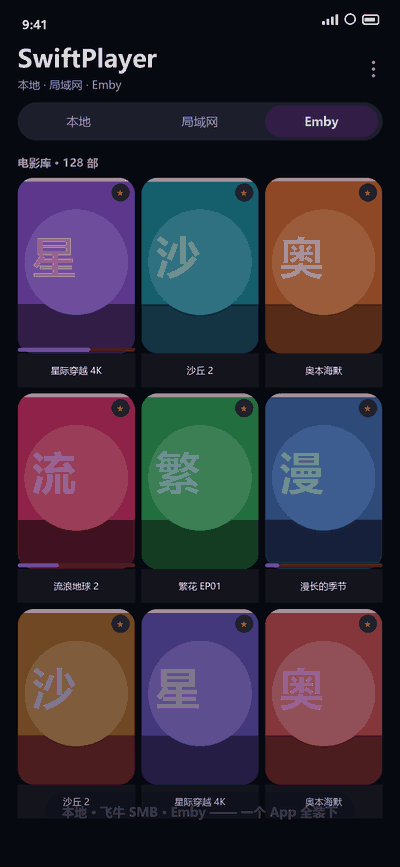

<div align="center">

# SwiftPlayer for Android

**Seek without the spinner.**

A native Android player for self-hosted home theater — local files, SMB shares (fnOS / Synology) and Emby, all in one app.

*[中文说明](README.md) · English*


[](https://github.com/cptbt22/SwiftPlayer-Android/releases/latest)



</div>

---

## Why this exists

Self-hosted media players all share one annoyance: you drag the seek bar and the picture freezes while a spinner catches up. A two-hour film, you want to skip the intro — three drags later, you have given up.

The usual options each miss something:

| Option | The gap |
|---|---|
| NAS built-in players | Long buffering when seeking over the internet |
| Third-party Emby / Jellyfin clients | Mostly WebView shells; gestures and seeking feel sluggish |
| MX Player / VLC | Local files only — no SMB share, no Emby library |
| Emby official client | Tap-based gestures, no progressive seek or commit-on-release |

SwiftPlayer is written in native Kotlin on top of Media3. Three mechanisms remove the wait:

| Mechanism | What it does | What it saves |
|---|---|---|
| **True random access over SMB** | Custom Media3 `DataSource` built on smbj. Connection and session are reused for the whole playback; a seek only reopens the file handle | No re-handshake per seek |
| **LAN preference for Emby** | Stores a WAN and a LAN address, probes every 60s (1.5s timeout). At home it talks to your NAS directly | No round-trip through your WAN link |
| **Preview seek** | Dragging only updates the HUD preview (target time, delta, thumbnail). One `seekTo` is committed when you release; `ACTION_CANCEL` commits nothing | No seek storm while dragging |

Buffer policy: 15s to start, 60s ceiling, 45s back-buffer. Network streams use `SeekParameters.CLOSEST_SYNC`, local files keep `EXACT`.

## Features

### One-thumb playback

Every control is reachable with a single thumb — lying down, on a train, eating noodles:

- **Progressive horizontal seek** with a power-curve acceleration (`|x|^1.7`): small drags fine-tune by seconds, large drags jump 20+ minutes. HUD previews the target time, the delta and a thumbnail; nothing is committed until you release
- **Portrait playback**: portrait videos go full-screen vertically, landscape stay landscape. A toolbar button cycles auto / landscape / portrait, and the choice is remembered
- **Long-press speed**: 2x on press, drag right for 3x / 4x, left back to 2x, restore on release
- **Double-tap**: left / right ±10s, centre play-pause
- **Vertical drag**: brightness on the left half, volume on the right

### Three sources, one entry point

| Source | What you get |
|---|---|
| **Local** | System media library plus "all files access" browsing, including dot-folders; thumbnails, duration, resolution |
| **SMB** | fnOS / Synology / Windows shares. True random access, blank share name auto-detected, breadcrumb navigation. Failures are attributed in plain language (service off / bad credentials / no permission / share missing) |
| **Emby** | Native API client, not a WebView — see below |

### Emby, integrated properly

Not "it can open an Emby link" — the library actually works on the phone:

- **Cast browsing** aggregated by filmography, with avatar grid and in-page search
- **Genre filter** with per-genre counts, filtered locally
- **Favourites**, **server-wide search**, **similar titles**
- **Two-way progress sync** via the official Playback Check-ins API — start on the phone, resume on the TV from the same second
- **Continue watching** with progress bars on the posters
- **External subtitles** parsed and side-loaded in one tap
- **Admin delete** for library entry, media file and metadata
- **LAN preference** so seeking at home bypasses the WAN
- **Built-in DoH resolver**: when the system DNS returns nothing, it falls back to DNS-over-HTTPS (AliDNS, bootstrapped by IP literals) — self-hosted domains that only publish AAAA records still resolve
- **Layered diagnostics**: on failure it reports resolved A/AAAA records, per-address TCP timing and the HTTP status, so you can see which layer broke

### Speech-to-subtitle

No subtitle track? The app sends audio through the system speech recogniser and overlays live subtitles. Eight languages:

> 日本語 · 한국어 · 简体中文 · 繁體中文 · English · Français · Deutsch · Español

Useful for unsubtitled foreign films, series and documentaries. One toggle in the player toolbar.

## Download

| Version | Size | Requires | Link |
|---|---|---|---|
| **Latest** (v2.5.6) | 5.8 MB | Android 7.0+ | **[GitHub Releases](https://github.com/cptbt22/SwiftPlayer-Android/releases/latest)** |

- All builds share the same signing key, so updates install straight over the previous version — no uninstall needed.
- Android will ask you to allow installs from unknown sources the first time.
- Checksums and older builds are on the [Releases](https://github.com/cptbt22/SwiftPlayer-Android/releases) page.

## Build

```bash
git clone https://github.com/cptbt22/SwiftPlayer-Android.git
# open in Android Studio, or:
./gradlew :app:assembleDebug
```

No signing key ships with the repo. For a release build, either put your own `swiftplayer-release.jks` in the project root (already gitignored) and provide `SP_STORE_PASSWORD` / `SP_KEY_ALIAS` / `SP_KEY_PASSWORD`, or configure `sp.store.password` / `sp.key.alias` / `sp.key.password` in `local.properties`. Without a key the release build falls back to debug signing.

## Troubleshooting

**Emby says "cannot connect to server".**

Run *Test connection* — it returns a layered report:

| Result | Meaning | Fix |
|---|---|---|
| `DNS failed` | The host publishes only AAAA records and the current network returns none | v2.5.6+ retries over DoH automatically; if it still fails, the network has no working IPv6 route to the NAS |
| `TCP timeout` | Address resolved but nothing answers | Port not forwarded, or no IPv6 egress |
| `HTTP 401` | Reachable, credentials wrong | Check username / password |

**Seeking still stutters.**

- Over **Emby**: the video comes from a transcoding stream, so seeking asks the server to re-segment. Add the **LAN address** when setting up the server — at home the app switches to it automatically.
- Over **SMB**: make sure SMB2/3 is enabled on the NAS. Random access relies on connection reuse; a server that force-closes idle sessions will degrade.

## Requirements

- Android 7.0 (API 24) or newer
- Emby server 4.x (cast and genre browsing need scraped metadata)
- SMB2/3 for SMB sources (fnOS: File Manager → SMB)
- Speech-to-subtitle depends on the system speech recognition service

## Tech

[Kotlin](https://kotlinlang.org) · [Media3/ExoPlayer](https://github.com/androidx/media) · [OkHttp](https://github.com/square/okhttp) · [smbj](https://github.com/hierynomus/smbj) · [JmDNS](https://github.com/jmdns/jmdns) · [Glide](https://github.com/bumptech/glide) · [Material Components](https://github.com/material-components/material-components-android)

## Disclaimer

This is an unofficial third-party client for Emby servers, not affiliated with Emby LLC. *Emby* is a trademark of Emby LLC. *fnOS / 飞牛* belongs to its respective owner. *Android* is a trademark of Google LLC. For personal and educational use only — respect the laws of your jurisdiction and support legitimate content.

## License

[GPL-3.0](LICENSE) © 2026 SwiftPlayer contributors
