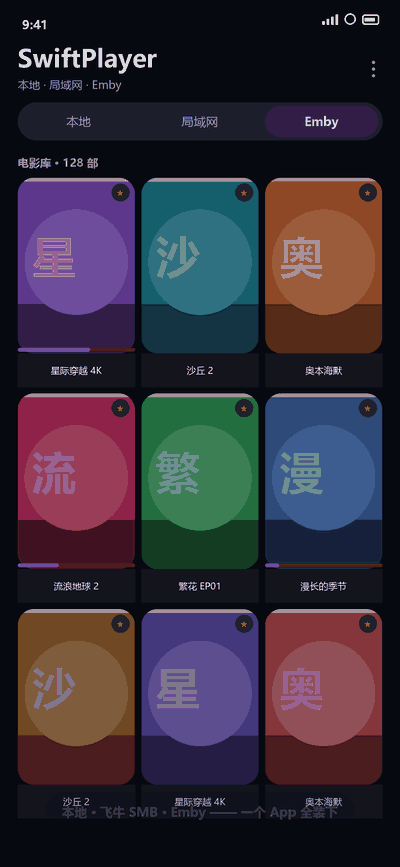

<div align="center">

# SwiftPlayer for Android

**为自建 NAS 家庭影院打造的 Android 播放器 —— 本地 · SMB（飞牛 NAS）· Emby 三合一**

*A self-hosted-home-theater video player for Android: local files, SMB (incl. fnOS NAS) and Emby in one app.*




</div>

---

## 为什么有这个项目

**起因是一个很具体的痛点。**

媒体库挂在飞牛 fnOS 的外接盘上，用手机看视频——在家连 Wi-Fi 也好、在外面走外网也好——**每拖一下进度条就要转圈好几秒**。一部两小时的电影想跳过片头，来回拖几次，耐心先没了。

市面上的方案各缺一块：

| 方案 | 缺的那一块 |
|---|---|
| NAS 自带的影视播放 | 外网拖动进度缓冲长，转圈等待 |
| Emby / Jellyfin 的第三方客户端 | 多为 WebView 套壳，手势与 seek 手感差 |
| MX Player / VLC 等本地播放器 | 只管本地文件，不认 SMB 共享与 Emby 媒体库 |
| Emby 官方 Android 客户端 | 闭源 |

SwiftPlayer 用 **Kotlin + Media3 原生实现**，直接对症：**拖动进度条不转圈**。同时把 **本地硬盘 / 局域网 SMB 共享 / Emby 媒体库** 装进同一个 App：**一只拇指完成快进、倍速、亮度、音量**；Emby 的演员、收藏、搜索、进度深度打通——手机上看一半，回客厅电视上同一秒续播；SMB 连不上时告诉你**为什么**，而不是甩一句"连接失败"。

## 核心：拖动进度条为什么不转圈

三个机制叠加，各吃掉一段延迟：

| 机制 | 做法 | 吃掉哪段延迟 |
|---|---|---|
| **SMB 真随机读取** | 基于 smbj 自实现 Media3 `DataSource`；连接与会话按播放生命周期复用，**seek 只重开文件句柄，不重建连接** | SMB 拖动不必重新握手，连续 seek 不卡 |
| **Emby 局域网优选** | 外网 + 内网双地址配置，60s TTL 探测（1.5s 超时打 `/System/Info/Public`），在家自动切内网直连 | 在家走局域网直连，快进不转圈 |
| **预览式 seek** | 拖动过程只更新 HUD 预览（目标时间 + 差值 + 缩略图），**松手才提交一次 `seekTo`**；`ACTION_CANCEL` 不提交 | 不会拖一下就 seek 一下，也不怕拖过头 |

配套缓冲策略：15s 起播 / 60s 上限 / **45s 回看缓冲**；网络流用 `SeekParameters.CLOSEST_SYNC`（本地保持 `EXACT`）。

## 功能亮点

### 🎬 单手手势播放（核心差异化）

所有播放操作**单手可达**——躺着、挤地铁、吃泡面，一只拇指看完一部电影：

- **横拖渐进式 seek**：幂函数加速曲线 `|x|^1.7`——小幅拖动秒级微调，大幅拖动一次跳 20+ 分钟（2h 电影：1 屏 ≈ 7 分钟，2 屏 ≈ 23 分钟），中心 HUD 实时预览目标时间、差值与缩略图，松手才提交，不怕拖过头
- **竖屏播放**：竖屏视频自动竖屏全屏、横屏视频横屏全屏（跟随视频宽高比），控制栏一键循环 自动 / 横屏 / 竖屏，偏好记忆
- **长按倍速**：长按 2x 起播，右拖升 3x / 4x，左拖回 2x，松手恢复原速——追剧看水份内容直接 4×
- **双击**：左 / 右 ±10s，中部播放暂停
- **竖拖**：左半屏亮度 / 右半屏音量，无需够到实体键

### 📂 三种片源，一个入口

| 片源 | 能力 |
|---|---|
| **本地** | 系统媒体库 + 「所有文件访问」浏览隐藏目录（`.` 开头文件夹），缩略图、时长、分辨率 |
| **SMB** | 飞牛 fnOS / 群晖 / Windows 共享；**真随机读取**（seek 只重开文件句柄，不重建连接）；共享名**留空自动识别**；子目录逐级浏览 + 返回键回退；连接失败**中文归因**（服务未开启 / 账号错误 / 无权限 / 共享不存在，附排查指引） |
| **Emby** | 原生 API 客户端（非 WebView），深度集成见下节 |

### 📺 Emby 深度集成

不是"能播 Emby 链接"，而是把 Emby 的媒体库能力完整搬到手机上：

- **演员浏览**：全库人物按出演影片数聚合排序（主角在前），带头像网格 + 页内搜索；点演员 → TA 的全部影片；只显示有效关联人物，不混入已删影片残留
- **类型筛选**：按 Genres（科幻 / 动作 / 剧情…）浏览，影片数计数，本地过滤秒切
- **收藏**：详情页一键收藏/取消，收藏夹独立入口
- **搜索**：服务器级全库搜索（影片/剧集），结果海报墙呈现
- **相似推荐**：详情页自动带出同类影片横滑列表
- **进度双向同步**：播放中按官方 Playback Check-ins 上报，手机上看一半，回电视上**从同一秒续播**
- **继续观看**：播放过的影片与进度一目了然，海报底边进度条显示已看百分比，一键续播；可在设置中关闭
- **跨设备续播**：详情页显示"上次看到 X 分钟 · 已看 Y%"，一键续播
- **外挂字幕**：自动解析外挂文本字幕轨，一键 side-load
- **管理能力**：管理员账号可直接删除影片（库条目 + 媒体文件 + 刮削文件）
- **局域网优选**：外网 + 内网双地址，在家自动切内网直连——快进不转圈

### 🗣️ 语音转字幕（无字幕外语片救星）

片源没有字幕轨？调用系统语音识别，把对白**实时转成字幕**显示在画面上。支持 8 种语言：

> 日本語 · 한국어 · 简体中文 · 繁體中文 · English · Français · Deutsch · Español

适合没有字幕的外语片、剧集与纪录片。播放器工具栏一键开关，识别中 / 错误状态可见。

### 🧠 为自建 NAS 优化的工程细节

- **SMB 数据源**：基于 smbj 实现的 Media3 `DataSource`，按播放生命周期复用连接，连续 seek 不卡顿
- **路径规范**：全链路 UNC 反斜杠规范化（踩过 smbj `/` 分隔符的坑）
- **错误归因**：SMB 异常按 NTSTATUS 分类透出（LOGON_FAILURE / ACCESS_DENIED / BAD_NETWORK_NAME…），不吞成"连接失败"
- **深色锁定** + M3 视觉体系，深浅色系统下 UI 一致
- 核心手势策略有 **单元测试** 覆盖

## 谁适合用

- ✅ 自建 NAS（飞牛 fnOS / 群晖 / Windows 共享），想在手机上**流畅拖进度条**看片
- ✅ 用 Emby，但想要更好的单手手势与原生体验
- ✅ 本地下载了一堆 mkv/mp4，要能浏览隐藏目录、外挂字幕
- ✅ 看无字幕外语片，需要实时语音转字幕

暂不适合：需要转码档位选择、多用户管理、或 Jellyfin 服务端支持（当前只做 Emby）。

## 系统要求

- Android 7.0（API 24）及以上
- Emby 服务器 4.x（演员/类型浏览需刮削元数据）
- SMB 服务器需开启 SMB2/3（飞牛 fnOS：文件管理 → SMB）
- 语音转字幕依赖系统语音识别服务

## 构建

```bash
git clone https://github.com/cptbt22/SwiftPlayer-Android.git
# 用 Android Studio 打开，或：
./gradlew :app:assembleDebug
```

**签名说明**：项目不带签名密钥。Release 构建时：

1. 在项目根放置你自己的 `swiftplayer-release.jks`（**请勿提交到 Git**，已在 .gitignore 忽略）；
2. 通过环境变量 `SP_STORE_PASSWORD` / `SP_KEY_ALIAS` / `SP_KEY_PASSWORD`，或在 `local.properties`（已忽略）中配置 `sp.store.password` / `sp.key.alias` / `sp.key.password`；
3. 没有密钥时 Release 自动回退 debug 签名，方便本地安装测试。

## 使用

1. **Emby**：Emby 页 → 右下角 + → 填服务器地址（可另填局域网地址）→ 登录。演员/类型浏览依赖刮削器写入的人物与 Genres 元数据。
2. **SMB（飞牛 NAS）**：局域网页 → 手动添加 → 填 NAS 的 IP 与账号密码，**共享名可留空**（自动识别）；也可从扫描结果直接点击连接。若连接失败，请确认飞牛「文件管理 → SMB」已开启服务并勾选共享目录、用户已被授权。
3. **本地**：授予「所有文件访问」权限即可浏览全部存储。

## 项目结构

```
app/src/main/java/com/swiftplayer/
├── player/     # 手势状态机、seek 策略（可测纯函数）、seek HUD、语音转字幕
├── smb/        # SMB 浏览客户端、随机读取 DataSource、路径规范、局域网发现
├── data/emby/  # Emby API / 仓库层（地址优选、播放决策、进度同步）
└── ui/         # 主页三 Tab、Emby 视图态机、播放器控制
```

## 技术栈与致谢

[Kotlin](https://kotlinlang.org) · [Media3/ExoPlayer](https://github.com/androidx/media) · [OkHttp](https://github.com/square/okhttp) · [smbj](https://github.com/hierynomus/smbj) · [JmDNS](https://github.com/jmdns/jmdns) · [Glide](https://github.com/bumptech/glide) · [Material Components](https://github.com/material-components/material-components-android)

感谢以上开源项目，本项目站在它们的肩膀上。

## 商标声明与免责

- 本项目是 **Emby 服务器的非官方第三方客户端**，与 Emby LLC 无任何隶属或合作关系。*Emby* 是 Emby LLC 的商标。
- *飞牛 / fnOS* 为其权利方的商标/产品，本项目与其无隶属关系，相关提示文字仅为帮助用户排查连接问题。
- *Android* 是 Google LLC 的商标。
- 本项目仅供个人学习与技术研究，请遵守所在地法律法规，支持正版内容。使用本项目产生的任何后果由使用者自行承担。
- 界面演示动图为示意图，实际效果以真机运行为准。

## License

[GPL-3.0](LICENSE) © 2026 SwiftPlayer contributors

使用本项目代码的衍生作品需同样以 GPL-3.0 开源。欢迎 Issue / PR。
